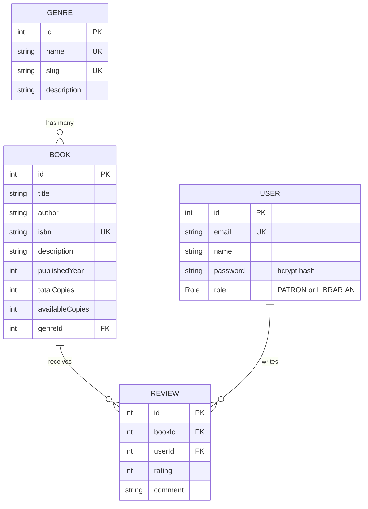

# Library Management System

A library's book catalog and a secure API for it, built with **NestJS**, **Prisma** and **PostgreSQL**.
Patrons and librarians are users, books belong to genres, and patrons can review books.
Anyone can browse the catalog. Only librarians can add, change or remove books and genres.

## Tech stack

| Part | Choice |
| --- | --- |
| API framework | NestJS (TypeScript) |
| ORM | Prisma 6 |
| Database | PostgreSQL hosted on Supabase, tables kept in their own `library` schema |
| Seeding | `prisma/seed.ts`, run with `tsx` |
| Validation | `class-validator` DTOs and a global `ValidationPipe({ whitelist: true })` |
| Authentication | JWT (`@nestjs/jwt`, `passport-jwt`), passwords hashed with `bcrypt` |
| Authorization | `@Roles()` decorator and a `RolesGuard` |
| Rate limiting | `@nestjs/throttler` on the login route |

## Data model



The full definition is in [`api/prisma/schema.prisma`](api/prisma/schema.prisma).

## Getting started

You need Node.js 20 or later and a PostgreSQL database.

```bash
cd api
npm install
cp .env.example .env        # on Windows PowerShell: Copy-Item .env.example .env
# edit .env: set DATABASE_URL to your own database and JWT_SECRET to a long random string

npx prisma migrate dev      # apply the migrations and create the tables
npx prisma db seed          # 5 genres, 20 books, 4 users, 4 reviews
npm run start:dev           # start the API on http://localhost:3000
```

`.env` is ignored by git. The repository only contains [`api/.env.example`](api/.env.example), which holds
placeholders and no real credentials.

To look at the data, run `npx prisma studio` from the `api` folder. Run the unit tests with `npm test`.

The seed creates two logins you can use straight away (password `Password123!`):
`librarian@example.com` (role LIBRARIAN) and `amani@example.com` (role PATRON).

## API

| Method and path | Who can call it | What it does |
| --- | --- | --- |
| `POST /auth/register` | anyone | Create a PATRON account. The password is hashed with bcrypt before saving |
| `POST /auth/login` | anyone, 5 tries per minute | Returns `{ access_token }`, a JWT signed with `JWT_SECRET` |
| `GET /users/profile` | any logged-in user | The current user, read from the request (never includes the password) |
| `GET /genres`, `GET /genres/:id` | anyone | List genres with book counts, or one genre with its books |
| `POST /genres`, `PATCH /genres/:id`, `DELETE /genres/:id` | LIBRARIAN | Create, update, remove a genre |
| `GET /books` | anyone | List books. Query: `genreId`, `search` (title or author), `page`, `limit` |
| `GET /books/:id` | anyone | One book with its genre |
| `POST /books`, `PATCH /books/:id`, `DELETE /books/:id` | LIBRARIAN | Create, update, remove a book |

`GET /books` returns `{ data, meta: { total, page, limit, totalPages } }`. For example,
`GET /books?genreId=2&search=dune&page=1&limit=5`. `page` starts at 1 and `limit` is capped at 100.

Send the token on protected routes as `Authorization: Bearer <access_token>`.
Status codes: 400 invalid data, 401 missing or bad token, 403 wrong role, 404 not found, 409 duplicate or genre still in use.

A ready-made request for every endpoint is in [`docs/postman_collection.json`](docs/postman_collection.json).
Import it into Postman, run `Login (librarian)` first, and the token is saved for the other requests.

## How authentication and authorization work

1. **Register.** `RegisterDto` checks the email and password. The password is hashed with bcrypt (10 salt rounds)
   and only the hash is stored. New accounts are always `PATRON`.
2. **Login.** The service compares the password with the stored hash and returns a JWT containing the user id,
   email and role. The same error message is used for an unknown email and a wrong password.
3. **JwtAuthGuard** (`AuthGuard('jwt')`) runs `JwtStrategy`, which verifies the token with `JWT_SECRET`, loads
   the user from the database, and puts `{ userId, email, role }` on `req.user`.
4. **RolesGuard** reads the roles named by `@Roles(...)` on the route and compares them with `req.user.role`.
   Book and genre create, update and delete routes use `@Roles(Role.LIBRARIAN)`.
5. **Validation.** Every create and update body is a class-validator DTO. `ValidationPipe({ whitelist: true })`
   removes any property that is not declared on the DTO, so a request cannot sneak in a `role` or an `id`.

Checking the role only in a frontend would not be secure, because anyone can call the API directly. These checks
happen on the server for every request.

## Schema Decisions

### Why Book references Genre instead of embedding it

A `Book` stores only a `genreId` foreign key, and the genre itself lives once in the `Genre` table.
I chose this over copying the genre name or description into every book for these reasons:

- **One source of truth.** A genre's name and description are stored once. Renaming "Science Fiction" is a single
  update, and every book reflects it. Embedded copies would have to be changed on every book, and any copy
  that was missed would silently disagree with the rest.
- **The database protects integrity.** The foreign key means a book cannot point at a genre that does not exist,
  and a genre that still has books cannot be deleted by accident (the default `Restrict` behaviour).
- **Genres are queried in their own right.** Listing all genres, counting books per genre, or finding every book
  in a genre are simple indexed lookups (`@@index([genreId])`) rather than scans through book rows.
- **It fits the database.** PostgreSQL is relational, and relationships between tables are expressed with
  foreign keys. Prisma's `@relation` maps directly onto that and gives typed access in both directions
  (`book.genre` and `genre.books`).

The cost is one extra lookup when reading a book together with its genre. Prisma handles that with
`include: { genre: true }`, so the application code stays simple.

### Other decisions

- **`Role` is an enum (`PATRON`, `LIBRARIAN`).** There are only two roles, and an enum makes the database reject
  any other value. `PATRON` is the default, so a new account never gets elevated access by accident.
- **`@@unique([title, author])` and a unique `isbn` on `Book`.** They stop the same book being added twice, and they
  let the seed script use `createMany` with `skipDuplicates`, so running the seed again does not create duplicates.
- **`totalCopies` and `availableCopies`.** One number is how many copies the library owns and the other is how many are
  on the shelf, which is what lending will need later. A new book starts with every copy available.
- **`User.password` holds a bcrypt hash.** The plain password is never stored, and the API never returns the hash.
- **`Genre.slug`.** A unique URL-friendly name such as `science-fiction`. It is built from the name when not supplied.
- **`Review` has `@@unique([bookId, userId])`.** A user can review a book once. Deleting a book or user removes their
  reviews (`onDelete: Cascade`), because a review has no meaning without both sides.
- **Rating range.** Prisma has no built-in check constraint, so the 1 to 5 limit on `rating` must be enforced in
  the application layer (for example with a DTO validator) when review endpoints are added.
- **A dedicated `library` schema.** The tables are created in their own PostgreSQL schema, selected with
  `?schema=library` in `DATABASE_URL`. This keeps them apart from other projects in the same database, and out of
  the schema that Supabase exposes through its public API.

## Stretch: Prisma versus a document database

In a document database such as MongoDB, my first instinct for a book would be to store the genre inside the book
document, something like `{ title, author, genre: "Fiction" }`. That is quick to write, and reading a book needs
no join. In Prisma the schema made me decide up front that a genre is its own thing and that a book points at it
with `genreId`. What felt most different is that the database itself now enforces the rule: I cannot create a book
with a genre that does not exist, and `include: { genre: true }` returns the joined data with full types. The
trade-off is that I have to think about relationships and run migrations before I can write data, whereas a
document database lets me change the shape of documents as I go.
