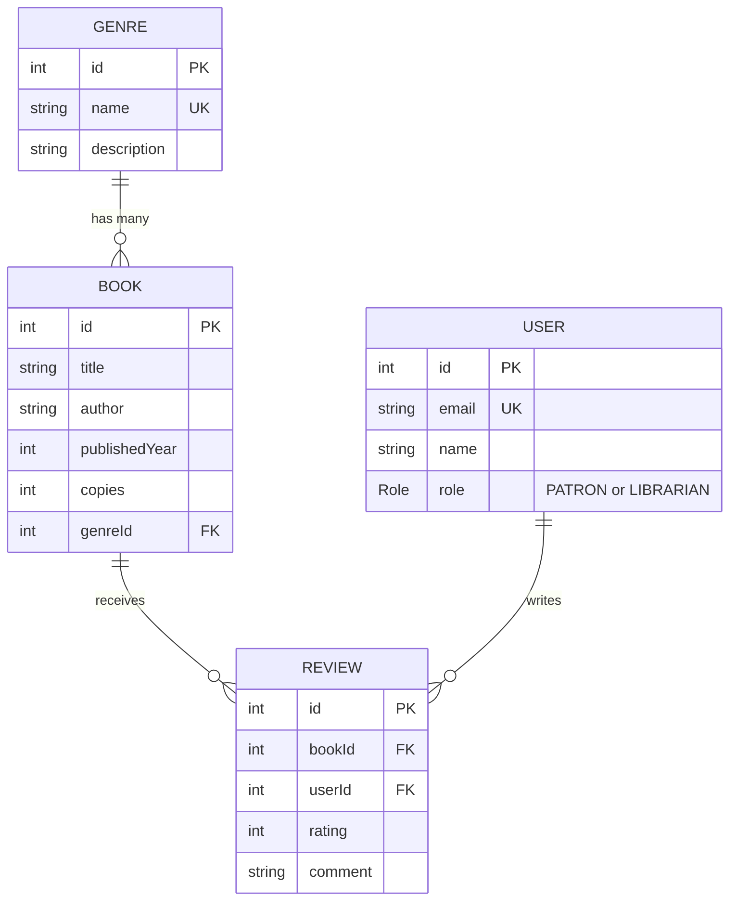

# Library Management System

The data layer for a library's book catalog, built with **NestJS**, **Prisma** and **PostgreSQL**.
Patrons and librarians are users, books belong to genres, and patrons can review books.

## Tech stack

| Part | Choice |
| --- | --- |
| API framework | NestJS (TypeScript) |
| ORM | Prisma 6 |
| Database | PostgreSQL hosted on Supabase, tables kept in their own `library` schema |
| Seeding | `prisma/seed.ts`, run with `tsx` |

## Data model



The full definition is in [`api/prisma/schema.prisma`](api/prisma/schema.prisma).

## Getting started

You need Node.js 20 or later and a PostgreSQL database.

```bash
cd api
npm install
cp .env.example .env        # on Windows PowerShell: Copy-Item .env.example .env
# edit .env and set DATABASE_URL to your own database

npx prisma migrate deploy   # create the tables
npx prisma db seed          # insert 5 genres, 20 books, 4 users and 4 reviews
npm run start:dev           # start the API
```

`.env` is ignored by git. The repository only contains [`api/.env.example`](api/.env.example), which holds a
placeholder `DATABASE_URL` and no real credentials.

To look at the data, run `npx prisma studio` from the `api` folder.

## Schema Decisions

### Why Book references Genre instead of embedding it

A `Book` stores only a `genreId` foreign key, and the genre itself lives once in the `Genre` table.
I chose this over copying the genre name or description into every book for these reasons:

- **One source of truth.** A genre's name and description are stored once. Renaming "Science Fiction" is a single
  update, and every book reflects it. Embedded copies would have to be changed on every book, and any copy
  that was missed would silently disagree with the rest.
- **The database protects integrity.** The foreign key means a book cannot point at a genre that does not exist,
  and a genre that still has books cannot be deleted by accident (the default `Restrict` behaviour).
- **Genres are queried in their own right.** Listing all genres, counting books per genre, or finding every book
  in a genre are simple indexed lookups (`@@index([genreId])`) rather than scans through book rows.
- **It fits the database.** PostgreSQL is relational, and relationships between tables are expressed with
  foreign keys. Prisma's `@relation` maps directly onto that and gives typed access in both directions
  (`book.genre` and `genre.books`).

The cost is one extra lookup when reading a book together with its genre. Prisma handles that with
`include: { genre: true }`, so the application code stays simple.

### Other decisions

- **`Role` is an enum (`PATRON`, `LIBRARIAN`).** There are only two roles, and an enum makes the database reject
  any other value. `PATRON` is the default, so a new account never gets elevated access by accident.
- **`@@unique([title, author])` on `Book`.** It stops the same book being added twice, and it lets the seed script
  use `upsert`, so running the seed again does not create duplicates.
- **`Review` has `@@unique([bookId, userId])`.** A user can review a book once. Deleting a book or user removes their
  reviews (`onDelete: Cascade`), because a review has no meaning without both sides.
- **Rating range.** Prisma has no built-in check constraint, so the 1 to 5 limit on `rating` must be enforced in
  the application layer (for example with a DTO validator) when review endpoints are added.
- **A dedicated `library` schema.** The tables are created in their own PostgreSQL schema, selected with
  `?schema=library` in `DATABASE_URL`. This keeps them apart from other projects in the same database, and out of
  the schema that Supabase exposes through its public API.

## Stretch: Prisma versus a document database

In a document database such as MongoDB, my first instinct for a book would be to store the genre inside the book
document, something like `{ title, author, genre: "Fiction" }`. That is quick to write, and reading a book needs
no join. In Prisma the schema made me decide up front that a genre is its own thing and that a book points at it
with `genreId`. What felt most different is that the database itself now enforces the rule: I cannot create a book
with a genre that does not exist, and `include: { genre: true }` returns the joined data with full types. The
trade-off is that I have to think about relationships and run migrations before I can write data, whereas a
document database lets me change the shape of documents as I go.
